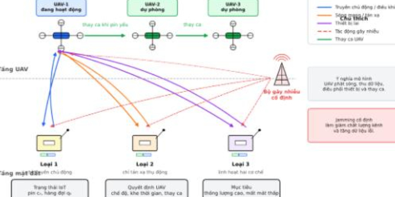

# Breakthrough in 864-Dimensional Action Space of Triple Jump - QMIX-Hierarchical Multi-UAV Collaborative Communication Method Full Analysis with Python Code

Three-level leap breakthrough in 864-dimensional action space - QMIX-Hierarchical multi-UAV collaborative communication method full analysis guide: In the complex electromagnetic environment of battlefields or disaster areas, mobile jammers continuously suppress communication signals, and ground IoT devices have limited battery life and uneven distribution. How to let multiple UAVs autonomously coordinate, while avoiding interference and efficiently serving all devices? This article introduces a three-tier progressive multi-agent deep reinforcement learning method - MaDRL (Multi-agent Deep Reinforcement Learning), which achieves an increase in throughput from baseline 0.32 to 0.96 in simulations, reducing the failure rate of interference by 66%.
I. Introduction: When UAVs encounter "uncivilized" mobile jammers
Imagine this scenario:
In a 500m×500m area, there are 15 IoT sensors scattered around—some monitoring temperature, some collecting vibration data. Their batteries are pitiful, and their communication capabilities vary. There are two UAVs flying above, acting as "airborne base stations," needing to fly over the equipment, select the appropriate communication mode, and collect data.
But the problem arises—there is also a mobile jammer on the ground, like a "bad guy" chasing the UAVs, constantly transmitting high-power interference signals, causing a sudden drop in signal-to-noise ratio and a large amount of data packet loss.
More challenging:
IoT devices come in three models, each excelling in different communication methods (active transmission vs reverse scattering)
The devices have limited battery life, requiring careful management of charging and communication
UAVs cannot "fight" among themselves—they must not service conflicts, nor can they collide in the air
The jammer itself is also "tired," needing to find an RF source for recharging after being drained, then return to harass again
This is the core issue that **UAV-MaDRL project (Project SkyShield)** needs to solve.
II. System Modeling: Six roles in one play
2.1 Scenario overview
The entire system consists of four types of entities:
Entity Role Key attributes
UAV (Unmanned Aerial Vehicle) × 2 Airborne Communication Relay
Fixed height of 100m, 9 directions of movement (including hover), coverage radius of 50m
IoT Device × 15 Data Acquisition Nodes
3 types, randomly distributed in a 500×500 area, each with data queue and energy budget
Jammer (Interferer) × 1 Mobile Interference Source
Moving at about 60%-100% of the UAV's speed, tracking the nearest UAV, with energy limitations
RF Source × 1 Radio Frequency Energy Source
Transmitting carrier signals, whose busy/idle status determines channel availability
2.2 Three "personalities" of IoT devices are not all alike - system designs three types, each with its own characteristics:
Type 1 — "Active Transmission Type" can actively send 2 packets of data per slot, consume only 1 unit of energy, but has weak reverse scattering capability (1 packet/slot). Initially has abundant energy (4-8), and battery capacity is also large (15). Like a "big eater", eats a lot and works fast. Type 2 — "Reverse Scattering Type" bidirectional balance: active transmission and reverse scattering both are 2 packets/slot, but the energy consumption doubles (2 units). Initially has less energy (1-4), battery capacity is 10. Suitable for "stealing" the carrier signal from the RF source for reverse scattering communication. Type 3 — "Flexible Dual Model" two models each have 1 packet/slot, with the highest active transmission energy consumption (3 units). Initially has the lowest energy (0-2), battery capacity is only 6. The most "poverty" but the most flexible. This heterogeneous design closely resembles real Internet of Things scenarios: not all devices are suitable for a unified scheduling strategy.
2.3 Six communication modes each device can choose one of the following modes in each slot:
Conditions | Effects ||------|----------|------|| Idle (idle) | None | No communication, sleep mode for power saving || Harvest (energy harvesting) | RF channel busy | Collect energy from the RF source signal for charging || Backscatter (backscatter) | RF channel busy + data queue | Use the environment's RF signals to reflect and transmit data, almost no power consumption || Active (active transmission) | RF channel idle + energy | Actively send data, with higher power consumption || Relay (relay) | — | Placeholder mode for expanding scenarios || Avoid jammer (avoid interference) | — | Actively avoid jammers to gain a safe reward
Here's a clever design: harvest and backscatter both rely on RF channels being busy, while active requires channels to be idle. This means that the device needs to dynamically switch modes based on the status of the RF source—just like traffic lights at a crossroads, directing different directions of traffic flow.
2.4 Channel Model and Transmission Success Probability: Communication Quality is Determined by **SINR (Signal to Interference plus Noise Ratio)**
2.5 The "smart" energy management of the jammer (innovation point) The jammer is not "unlimited firepower". The project has added a sophisticated mechanism:
The jammer has a maximum energy of 50, and is fully charged at the start.
Every step of interference consumes 0.5 energy.
Stop interference when energy is below 5, and start searching for an RF source to charge.
Navigation Algorithm: RSSI Climbing Method - compare the current RSSI with the previous step, if the signal is stronger, keep the direction; if it's weaker, randomly turn.
After charging to 30, the interference is restored (hysteresis mechanism, preventing frequent oscillations within the range of 5←→30).
This simulates the "stop and start" rhythm of real-world adversarial scenarios, making the simulation more realistic.
3. Methodology: From "Chaos" to "Collaboration" - Jump 3.0
Why not use traditional methods? What is the action space if drones are violently searching for optimal actions?
9 moving directions × 16 serviceable targets (15 devices + no target) × 6 communication modes = 864 dimensions
This is what is known as the combination explosion. Traditional Q-learning cannot converge in this space.
The research team designed a clear three-tiered progression:
3.1 First level: Flat DDQN (Benchmark)💡 The idea: Directly learn with DDQN in the 864-dimensional original action space. Network architecture: Centralized-Factorized DDQN, where all UAVs share a Q network and differentiated by UAV ID.
Results: Throughput only 0.3242, almost the same as the "pure active transmission" heuristic method (0.3278), far less than "backscatter priority" (0.8522).
Diagnosis: The 864-dimensional action space is like an ocean of vastness, where agents can't find effective gradient signals. Action space must be compressed.
3.2 Second level: Hierarchical DDQN (Hierarchical Action Affinity) This is the most critical breakthrough.
💡 The core idea: Abstract the 864-dimensional original action into 10 high-level strategic actions, translated by rule-based executors into specific operations. 10 high-level strategic actions: #
High-level action
Meaning
1  
IDLE_SAFE🛡️ Safe and idle, save energy, away from danger
2  
SERVE_NEAREST_QUEUE📍 Fly towards the nearest queue of data to be served
3  
SERVE_BEST_SINR📶 Select the device with the best signal quality for service
4
PRIORITIZE_BACKSCATTER_TYPE23🔄 Prioritize Type 2/3 devices for backscatter (energy-saving)  
5  
PRIORITIZE_ACTIVE_TYPE1⚡ Prioritize Type 1 devices for active transmission (quickly clear queue)  
6  
HARVEST_LOW_ENERGY🔋 Harvest RF energy from low-energy devices  
7  
AVOID_JAMMER🏃 Avoid jammers to prevent interference  
8  
BALANCE_UNDERSERVED_IOT⚖️ Balance underserved IOT devices for priority service  
9  
HYBRID_BALANCED🔀 A hybrid balanced strategy, combining throughput and fairness  
10  
HIGH_QUEUE_PRIORITY📊 Pursue high queue pressure devices to prevent data overrun and packet loss  
How does the actuator work? Taking SERVE_NEAREST_QUEUE as an example:  
1  
Scan 15 devices to find those with data queues  
2  
Calculate the distance from UAV to each candidate device  
3  
Select the nearest device as the target  
4  
Determine the direction of movement (one of nine directions towards the target device)  
5  
Assess communication mode: RF idle → active transmission, RF busy → backscattering  
Other higher-level actions have their own rules and logic, collectively translating a 10-dimensional soft decision into precise 864-dimensional hard actions.  
Results are astonishing: Throughput surges from 0.3242 to 0.9710, nearly three times the increase!  
Conclusion: Act abstraction is key to solving large-scale action spaces, decoupling "what to do" and "how to do it."  
3.3 Third Level: QMIX-Hierarchical (Final MaDRL Scheme) Although Hierarchical DDQN performs well, it fundamentally remains independent learning—each UAV makes decisions using its own observations, lacking collaboration.
💡 QMIX core idea: Use a Mixer Network to combine the local Q-values of multiple agents into a global Q-value, while satisfying the monotonicity constraint, achieving centralized training and distributed execution (CTDE).QMIX architecture: ┌─────────────┐ │ Q_tot (global) │ ← global Q value └──────┬──────┘ │ ┌───────────┴───────────┐ │ QMixer hybrid network │ ← generate non-negative weights from the supernetwork └────────────┬───────────┘ │ ┌────────┴────────┐ │ Q_uav1 │ │ Q_uav2 │ ← eachThe local Q-values of an UAV └────┬────┘  └────┬────┘  │        │ ┌────┴────┐   ┌────┴────┐ │AgentNet1│   │AgentNet2│ ← Shared Weights Agent Q Network └─────────┘  └─────────┘Key Mechanism:
Monotonicity constraint: ∂Q_tot / ∂Q_u ≥ 0, ensuring that the global optimal action is equivalent to the combination of greedy choices by each agent.
Supernet: Dynamically generates mixed weights based on the global state as input, endowing it with a "big picture" perspective.
Concentrated training: Uses global information (all device states, all UAV positions) during training.
Distributed execution: Each UAV only needs local observations + shared Agent Q network for inference.
Network parameter configuration:
Parameters
Value
Hidden layer
[128, 128]
Mixed embedding dimension
32
Supernet hidden dimension
64
Learning rate
0.0005
0.99
Double Q-learning
✓
Target network update frequency
Every 200 steps
Observation space and state space: Local observation (per UAV): 97 dimensions (7 UAV state + 6×15 device states)
Global state (Mixer input): 70 dimensions (3 dimensions × 2 UAV + 4 dimensions × 15 devices + 2 dimensions × 1 jammer + 2 dimensions × global information)
R = + 1.0 × Successful Packets Count (Throughput Incentive) + 0.2 × Interference Bonus (Security Incentive) - 2.0 × Missed Packets Count (Drop Penalty, Highest Weight) - 0.1 × Mean Queue Length (Latency Pressure) - 0.01 × UAV Energy Consumption (Endurance Consideration) - 1.0 × Interference Failures (Anti-Interference Metric) - 5.0 × Collisions (Collision Penalty, Highest Priority) - 0.2 × (1 - Jain Fairness Index) (Service Fairness)
Considerations for Weight Design:
Collision Penalty Weight 5.0 is the highest—Safety is always the top priority.
Packet loss penalty 2.0 is second—Data integrity is crucial.
The fairness item introduces the Jain fairness index to prevent certain devices from being "forgotten".
IV. Experimental Results: The data validation of three-hop jumps was conducted in Scenario 4 with 2 UAVs, 15 IoTs, and 1 mobile jammer. Comparative results among methods are as follows:
Method
Throughput (packets/frame)
Interference failure rate↓
Fairness↑
Random (random strategy)
0.1075
—
—
HTT-only (active transmission only)
0.3278
—
—
Greedy SINR (greedy SINR)
0.4783
—
—
Backscatter-only (only backscatter)
0.8522
—
—
Greedy Nearest (greedy nearest)
0.8977
—
—
Flat DDQN0.32420.6093
0.1930
Hierarchical DDQN0.9710
⬆️
0.4403
0.4754
QMIX-Hierarchical (3 seeds)0.9604 ± 0.0255
🏆
0.2056 ± 0.0744
⬇️
0.5260 ± 0.0572
⬆️
Key Findings: 1
Action abstraction is a key breakthrough: Hierarchical DDQN improved throughput from 0.32 to 0.97, proving the effectiveness of 10 high-level actions.
2
QMIX brings synergy gains: Although QMIX's throughput is slightly lower than that of Hierarchical DDQN (0.9604 vs 0.9710), it reduces the failure rate by 53% (0.2056 vs 0.4403) and improves fairness by 10% (0.5260 vs 0.4754). The stability of three seed runs also far exceeds single run performance.
3
Fairness still has room for improvement: The Jain fairness index of 0.526 is at a medium level, with BALANCE_UNDERSERVED_IOT contributing to some fairness, but there is still room for optimization.
4
Backscattering is a "secret weapon": The backscatter-only heuristic method achieves a throughput of 0.8522, far surpassing active transmission methods, demonstrating the significant advantage of RF powered backscatter in saving device energy.
V.System Architecture Overview
┌─────────────────────────────────────────────────┐│ QMIX Training Loop ││ ├───────────────┐ ├──────────────────┐ ││ ├───────────────┐ ├──────────────────┐ ││ ├───────────────┐ ├──────────────────┘ ││ └─────┬───────┘ └───────────────────┘ ││ ├─────▼────────────────────────────┐ ├─────││ ├─────Replay Buffer││ ├─────││ ├─────││ ├─────││ ├─────││ ├─────││ ├─────││ ├─────││ ├─────││ ├─────││ ├─────││ ├─────││ ├─────││ ├─────││ ├─────││ ├─────││ ├─────││ ├─────││ ├─────││ ├─────││ ├─────││ ├─────││ ├─────││ ├─────││ ├─────││ ├─────││ ├─────││ ├─────││ ├─────││ ├─────││ ├─────││ ├─────││ ├─────││ ├─────││ ├─────││ ├─────││ ├─────││ ├─────││ ├─────││ ├─────││ ├─────││ ├─────││ ├─────││ ├─────││ ├─────││ ├─────││ ├─────││ ├─────││ ├─────││ ├─────││ ├─────││ ├─────││ ├─────││ ├─────││ ├─────││ ├─────││ ├─────││ ├─────││ ├─────││ ├─────││ ├─────││ ├─────││ ├─────││ ├─────││ ├─────││ ├─────││ ├─────││ ├─────││ ├─────││ ├─────││ ├─────││ ├─────││ ├─────││ ├─────││ ├─────││ ├─────││ ├─────││ ├─────││ ├─────││ ├─────││ ├─────││ ├─────││ ├─────││ ├─────││ ├─────││ ├─────││ ├─────││ ├─────││ ├─────││ ├─────││ ├─────││ ├─────││ ├─────││ ├─────││ ├─────││ ├─────││ ├─────││ ├─────││ ├─────││ ├─────││ ├─────││ ├─────││ ├─────││ ├─────││ ├─────││ ├─────##, Q2, state) │    ││ └────────────────────────────────────┘    ││    ▲        ▲           ││ ┌──────┴──────┐ ┌──────┴──────┐       ││ │ AgentNet U1 │ │ AgentNet U2 │       ││ │ (Shared weight) │ │ (Shared weight) │       ││ └──────┬──────┘ └──────┬──────┘       ││    │ High-level dynamicSelection │ │┌──────▼─────────────────────────┐││││││││││││││││││││││││││││││││││││││││││││││││││││││││││││││││││││││││││││││││││││││││││││││││││││││││││││││││││││││││││││││││││││││││││││││││││││││││││││││││││││││││││││││││││││││││││││││││││││││││││││││││││││││││││││││││││││││││││││││││││││││││││││││││││││││││││││││││││││││││││││││││││││││││││││││││││││││││││││││││││││││││││││││││││││││││││││││││││││││││││││││││││││││││││││││└────────────────────────────────┘──────────────────┐│        Simulation environment (Scenario 4)       ││                         ││ 🛸 UAV1 ←→ 🛸 UAV2              ││  │ ╲   ╱ │               ││  │ ╲  ╱ │               ││  ▼  ╲ ╱  ▼               ││ 📱📱📱 ⚡📱📱 📱📱📱 ← 15 IoT devices   ││  (Type1) (Type2) (Type 3)  ││ 📻 RF Source ──→ 🚫 Jammer (Tracking the Nearest UAV)  ││ Channel Model: Path Loss + SINR + Jammer Interference  ││ Transmission Model: Active Transmission / Reverse Scattering / Energy Harvesting  ││ Mobility Model: 9-directional grid mobility─────┘\nVI. Summary of technical highlights: 6.1 Action space compression from 864-dimensional raw actions to 10 high-level strategies. This is an elegant solution to the problem of dimensionality disaster. The actuator is rule-based (non-learning). However, the design of the rules is closely tied to domain knowledge - this is a prime example of combining expert knowledge with deep learning.
6.2 The clever utilization of reverse scattering communication by IoT devices to utilize existing RF signals in the environment for data transmission, consuming little energy from themselves. This is not a simple technology stack but the core of system design—allowing energy-constrained devices to "borrow strength".
6.3 The authenticity of the jammer energy model. The concept of the jammer as an "infinite ammunition" does not exist. The RSSI hill climbing charging mechanism and the 5→30 delay range simulate real combat gaps—making the simulation results more convincing.
6.4 Successful practice of the CTDE paradigm. Centralized training and distributed execution (CTDE) is the mainstream paradigm in multi-agent reinforcement learning today. QMIX achieves collaborative decision-making without sacrificing scalability through monotonicity constraints and hypernetworks.
VII. Limitations and Prospects⚠️ Current limitations (the author honestly declares in the report):
Only evaluated for 2 UAV / 15 IoT / 1 Jammer scenarios, larger scales have not been verified yet.
Reverse scattering is a system-level abstraction, not complete physical layer modeling.
Hierarchical actuators are based on rules, not end-to-end learning.
Fairness index is only 0.526, still has room for improvement.
Simulation results only, no hardware-in-the-loop verification.
🔮 Future directions:
Expand to more UAV and device scenarios.
Replace rule-based actuators with learning-based ones.
Introduce a more refined physical layer model.
Combine transfer learning to adapt to dynamically changing scenarios.
Perform semi-physical simulation verification on real hardware platforms.
VIII. Conclusion UAV-MaDRL project demonstrates a clear research path for multi-agent deep reinforcement learning:
Flat DDQN (exploration failure) → Hierarchical DDQN (action abstraction breakthrough) → QMIX-Hierarchical (collaborative optimization).
By taking three steps, not only has the throughput increased nearly threefold, but significant progress has also been made in terms of anti-interference capability and service fairness.
Behind this is the progressive wisdom of methodology:
1. Expose problems (864-dimensional action space unlearnable)
2  
Identify the crux of the issue (the action space needs to be abstracted)  
3  
Finalize the solution (introduce multi-agent collaboration)  
For practitioners in the fields of multi-drone communication, edge computing, and intelligent Internet of Things, this project's approach and code are worth studying and drawing on.  
📎 Project Information: UAV-MaDRL (Project SkyShield)📎 Core Methodology: Hierarchical Action Abstraction + QMIX Multi-Agent RL📎 Key Technologies: Double DQN, Hypernetwork, Centralized Training Decentralized Execution (CTDE), RF-Powered Backscatter Communication📎 Code Framework: Python + PyTorch + PettingZoo

## Images

<!-- PAYMENT_BLOCK -->

## Get this dataset

- Payment link (Stripe): [Buy now](https://buy.stripe.com/3cs8yP7sY87d0vu9AB)
- Payment QR code: 

<!-- /PAYMENT_BLOCK -->
